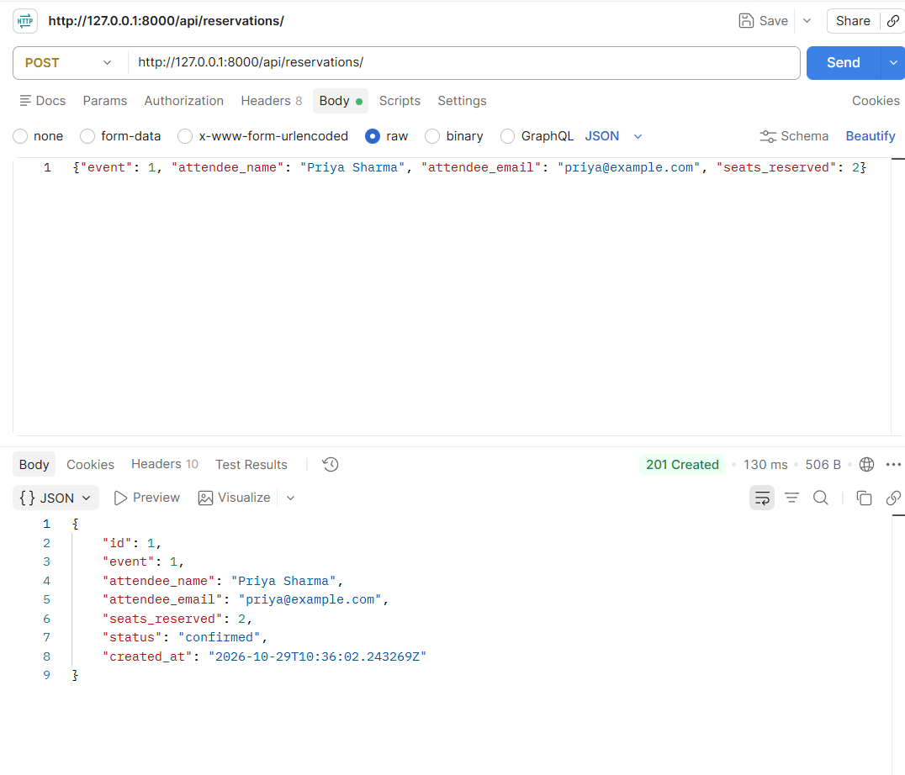
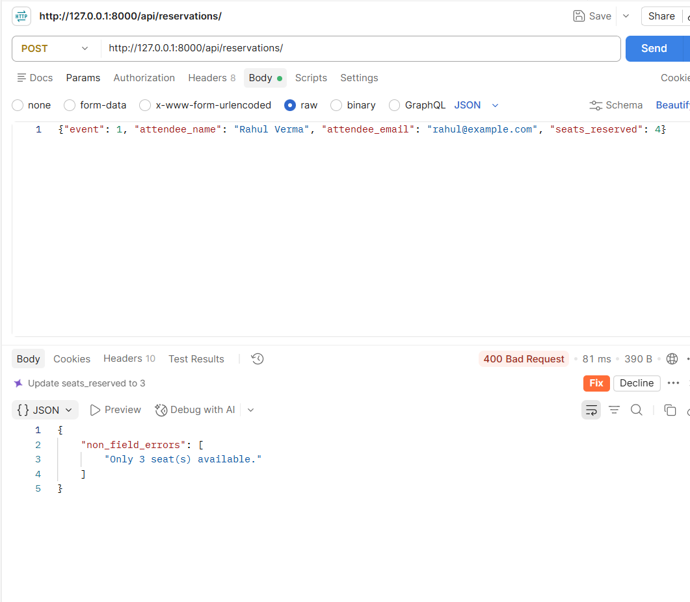
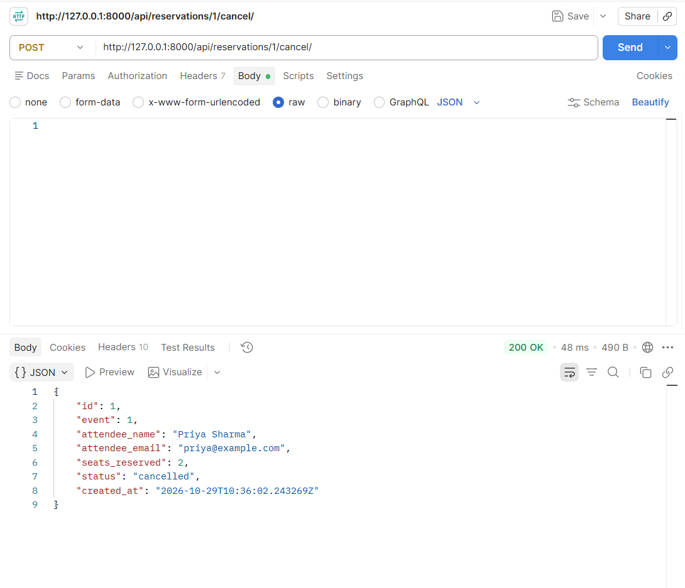

# EventHub

Backend API for a simplified event ticketing platform. Browse events, reserve seats and cancel reservations.
Built with Django, Django ORM, DRF serializers, ViewSets and a Router.

## How to run

```bash
python -m venv venv
venv\Scripts\activate        # Windows
# source venv/bin/activate   # Mac/Linux
pip install -r requirements.txt
python manage.py migrate
python manage.py runserver
```

API root: `http://127.0.0.1:8000/api/`

## Endpoints

### Events
| Method | URL | What it does |
|---|---|---|
| GET | `/api/events/` | List events. Filters: `?status=upcoming`, `?venue=bangalore` |
| POST | `/api/events/` | Create an event |
| GET | `/api/events/{id}/` | Get one event (includes `reservations_count`) |
| PUT/PATCH | `/api/events/{id}/` | Update an event |
| DELETE | `/api/events/{id}/` | Delete an event |

### Reservations
| Method | URL | What it does |
|---|---|---|
| GET | `/api/reservations/` | List reservations. Filter: `?event_id=1` |
| POST | `/api/reservations/` | Reserve seats (seats are deducted from the event) |
| GET | `/api/reservations/{id}/` | Get one reservation |
| POST | `/api/reservations/{id}/cancel/` | Cancel a reservation (seats are restored) |

## Middleware

`RequestLoggingMiddleware` (`events/middleware.py`) logs method, path, status code and time taken for every request to the terminal.

## Screenshots

- Successful reservation (201): 
- Overbooking failure (400): 
- Successful cancellation: 

## Design decision

I wrapped the seat deduction and the reservation creation in `transaction.atomic()`
inside `ReservationSerializer.create()`. These are two database writes: reduce
`available_seats` on the event, and create the `Reservation`. If the second write fails
after the first one succeeds, the event would lose seats with no reservation to show for it.
With `transaction.atomic()`, either both writes happen or neither does.

I also lock the event row with `select_for_update()` and re-check the available seats
inside the transaction. This protects against two users trying to book the last seat at the
same time on databases that support row locking (like PostgreSQL). The same approach is used
in the `cancel` action, so restoring seats and marking the reservation as cancelled stay in sync.
